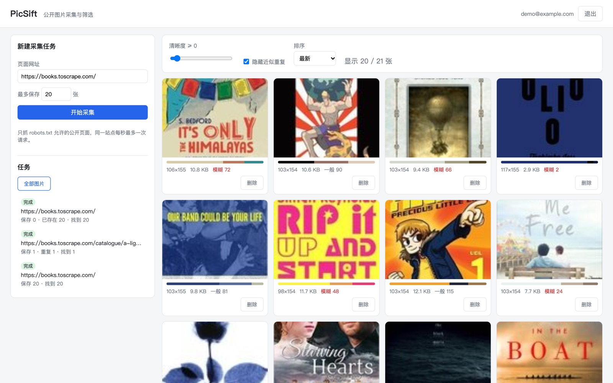
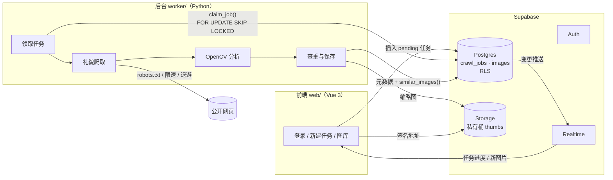
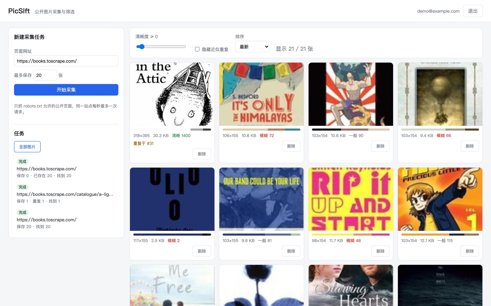

# PicSift

公开网页图片的采集与筛选工具：输入一个页面网址，后台程序按 robots.txt 规则礼貌地抓取页面里的图片，
用 OpenCV 计算清晰度、亮度、主色和感知哈希，自动把近似重复的图归成一组；前端实时看到任务进度和新图片，
可以按清晰度筛选、隐藏重复图。

只保存缩略图和分析结果，原图链接回源站。



## 在线体验

https://shemiyan.github.io/picsift/

- 前端由 GitHub Actions 构建并发布到 GitHub Pages，数据在 Supabase。国内网络访问 `*.supabase.co` 可能被重置，需要能访问外网。
- 采集任务由 worker 处理。worker 目前跑在作者本机，没运行时新任务会停在"排队中"，效果可以看本页截图。
- 公开环境任何人都能注册、提交任务，所以 worker 开了站点白名单，只抓练习站点 books.toscrape.com（见 #19）。

## 架构



## 技术要点

**礼貌爬取**（`worker/picsift/crawl.py`）
- 每个站点先读 robots.txt 并缓存；robots.txt 返回 5xx 或连不上时保守处理，整站不抓，
  报错里会区分"连不上"和"被 robots.txt 禁止"。
- 同一站点两次请求至少间隔 1 秒；遇到 429/503 按 `Retry-After` 退避，最多重试 3 次。
- 不信任 `Content-Type` 判断格式，按文件头识别；单张图超过 8 MB 边下边截断。
- 图片地址从 `img` 的 `src` / `data-src` / `srcset`（取最大一张）、`picture > source`、`og:image` 里找。
- 可选的站点白名单 `PICSIFT_ALLOWED_HOSTS`：前端公开部署后任何人都能提交任务，不加限制的话，worker 所在机器
  能访问的内网地址也会被当成采集目标。跳转改为手动跟随，每一跳发出前都检查名单，名单外的地址一次都不会被请求。

**图像分析**（`worker/picsift/imaging.py`）
- **感知哈希（dHash）**：缩成 9×8 灰度图，逐行比较相邻像素明暗得到 64 位哈希。缩放、重新压缩后哈希几乎不变，
  两张图哈希的汉明距离 ≤ 6 判为近似重复。哈希按有符号 64 位存进 Postgres `bigint`。
- **清晰度**：拉普拉斯算子的方差，边缘越锐利越大。长边统一缩放到 512（大图缩小、小图放大）再算，
  不同分辨率的图分数才可比；只缩不放时，100 像素宽的小图分数会偏高好几个数量级。
- **主色**：缩到 64×64 后用 k-means 聚类，固定随机种子保证同一张图结果稳定；占比不到 3% 的过渡色不计。



**数据库**（`supabase/migrations/0001_init.sql`）
- **任务队列**：`claim_job()` 用 `FOR UPDATE SKIP LOCKED` 领取任务，多个 worker 并发也不会领到同一个；
  待处理任务用部分索引（`where status = 'pending'`）。
- **查重在库里算**：`similar_images()` 里用 `bit_count((a # b)::bit(64))` 求汉明距离。现在是按用户全量比较，
  图多了可以把哈希切成几段分别建索引（多索引哈希）先筛候选。
- **权限**：表和存储桶都开了行级安全，用户只能看到自己的数据；前端只能新建 `pending` 任务，状态只有 worker 能改。
  worker 用 service_role 密钥，只放在 `.env`，不进前端也不进仓库；两个函数收回了前端角色的执行权限。

**前端**（`web/`）
- 任务列表和图库都订阅了 Realtime，worker 每存一张图前端立即出现。
- 私有桶的缩略图批量换成带签名的临时地址再显示。

## 本地运行

**1. Supabase**：新建项目，在 SQL Editor 里执行 `supabase/migrations/0001_init.sql`。

**2. worker**（Python 3.11+）

```bash
cd worker
python3 -m venv .venv && source .venv/bin/activate
pip install -r requirements-dev.txt

# 不连数据库，先抓一个页面看看效果（结果在 out/）。books.toscrape.com 是专供练习爬虫的站点
python -m picsift local "https://books.toscrape.com/" --limit 10

# 连 Supabase：把根目录 .env.example 复制成 .env 并填写，然后
python -m picsift worker
```

**3. web**（Node 20+）

```bash
cd web
cp .env.example .env.local   # 填项目地址和 Publishable key
npm install
npm run dev
```

## 部署

- 前端：推送到 main 后由 `.github/workflows/pages.yml` 构建并发布到 GitHub Pages。Supabase 地址和 Publishable key
  来自仓库变量 `VITE_SUPABASE_URL`、`VITE_SUPABASE_ANON_KEY`。
- worker：`worker/Dockerfile`，运行时用 `--env-file` 传入 `.env`。公开部署前端时必须设置 `PICSIFT_ALLOWED_HOSTS`。

## 测试

```bash
cd worker && ruff check . && pytest -q
cd web && npm run type-check && npm test
```

worker 的测试全部离线：用 `httpx.MockTransport` 模拟网站，用 OpenCV 生成测试图，覆盖 robots.txt、限速重试、
大小限制、哈希抗缩放/重压缩、清晰度和端到端流程。每个 PR 由 GitHub Actions 跑一遍。

## 目录

```
supabase/migrations/   表结构、函数、RLS、存储桶
worker/picsift/        crawl（爬取） imaging（分析） pipeline（流程） store（Supabase） __main__（命令行）
worker/tests/          pytest
web/src/               Vue 3 前端，lib/gallery.ts 是可单测的筛选逻辑
```

## 后续可做

- 每组近似重复保留质量最好的一张作为代表。现在保留的是先抓到的那张，上面截图里组首图反而是更小、更糊的版本。
- 查重改用多索引哈希先筛候选，避免按用户全量比较。
- worker 部署到服务器或定时运行，线上环境不再依赖作者本机。

## 开发方式

用 AI 编程代理辅助开发。每个功能先开 issue，在分支上实现，提 PR，CI 通过后合并。

## 使用须知

只用于抓取允许抓取的公开页面。请遵守目标网站的使用条款和图片的版权许可。
